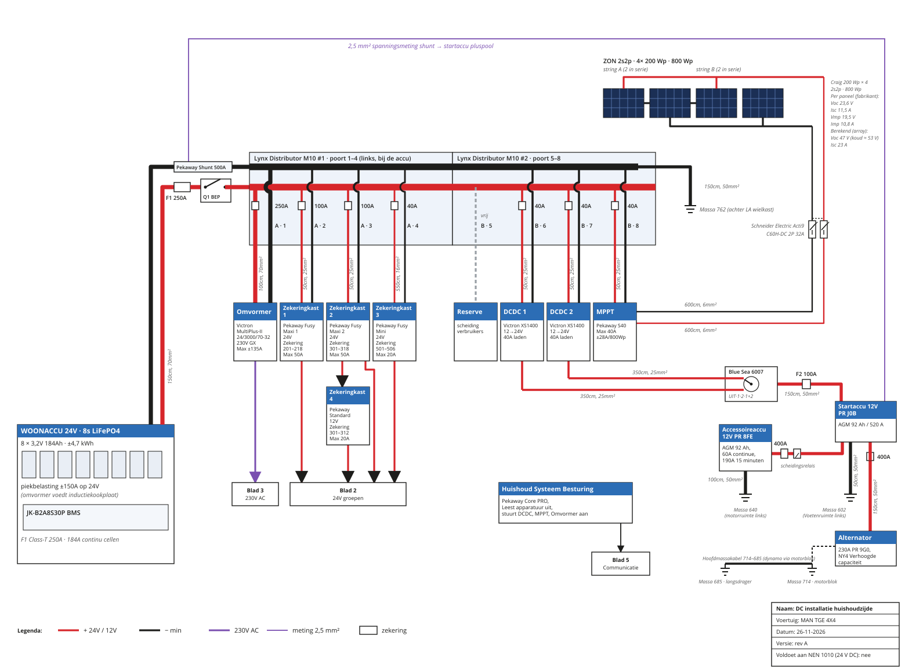
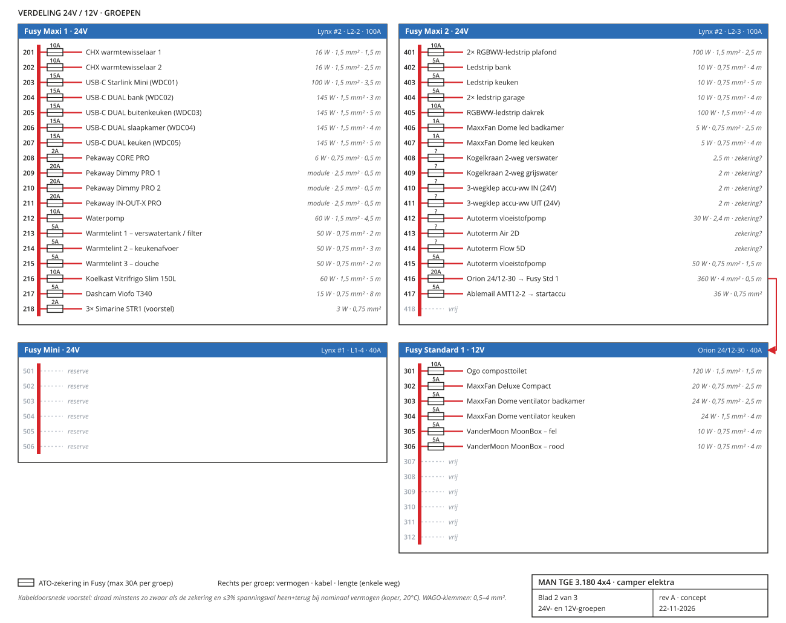

# Elektra

24V-huishoudsysteem met een zelfbouw LiFePO4-accu van ±4,7 kWh, Victron Lynx-verdeling, Pekaway Fusy-zekeringblokken en Pekaway VAN PI CORE PRO als besturing.

## Schema's

### Blad 1 – Energie & laden
Accu, hoofdzekering en hoofdschakelaar, Lynx-verdeling, laden via dynamo (2× Orion XS 1400) en zon (800 Wp, Pekaway S40), omvormer.

### Blad 2 – 24V- en 12V-groepen
Alle groepen per Fusy-blok met zekering, kabeldoorsnede en lengte (rev A).

### Blad 3 – 230V
*Nog te maken.*

## Kleurcodes
Victron-stijl: **rood** plus, **zwart** min, **blauw gestippeld** data/stuursignaal, **paars** 230V AC.

## Verder lezen
- [Aansluiten op het voertuig – conform VW-opbouwrichtlijn](voertuigaansluiting.md)
- [Componentenlijst](componentenlijst.md)
- [Zekeringen rev A – mapping tool](zekeringkast-rev-a.md)
- [Zekeringen rev B – voorstel op basis van echte stromen](zekeringen-rev-b.md)
- [Pekaway-specificaties](pekaway-specs.md)
