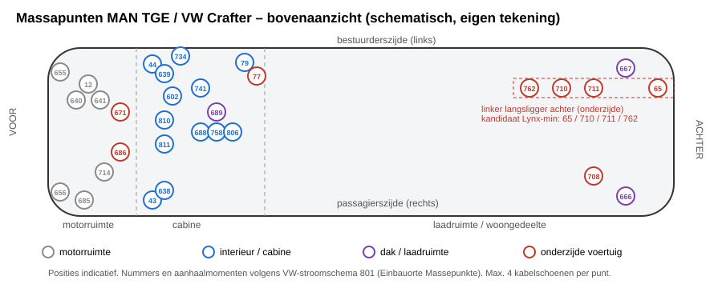

# Massapunten

Officiële massapunten van de carrosserie volgens VW-stroomschema **801 "Einbauorte – Massepunkte"** (Crafter vanaf MJ 2017, geldt ook voor de TGE). Volgens de opbouwrichtlijn mag de opbouw **alleen deze punten** gebruiken, met **maximaal 4 kabelschoenen per punt**. Massapunten van veiligheidssystemen (airbag, gordelspanners) niet gebruiken.

*Eigen schematische tekening; de posities zijn indicatief. De originele VW-tekeningen met exacte plekken staan in erWin (stroomschema 801) en in het eigen archief. Ze worden hier niet gepubliceerd, omdat ze auteursrechtelijk beschermd zijn.*

## Overzicht

| Nr. | Plek | Zone | Aanhaalmoment |
|---|---|---|---|
| 12 | motorruimte links | Z11 | 9 Nm |
| 640 | motorruimte links, punt 2 | Z11 | 20 Nm |
| 641 | motorruimte links, punt 3 | Z11 | 9 Nm |
| 655 | bij linker koplamp | Z11 | 9 Nm |
| 656 | bij rechter koplamp | Z11 | 20 Nm |
| 714 | rechts van de motor | Z11 | 20 Nm |
| 685 | rechter langsligger voor, punt 1 | Z11 | 20 Nm |
| 686 | rechter langsligger voor, punt 2 (onderzijde) | Z10 | 20 Nm |
| 671 | linker langsligger voor, punt 1 (onderzijde) | Z10 | 9 Nm |
| 44 | linker A-stijl, onderzijde | Z01 | 9 Nm |
| 639 | linker A-stijl | Z01 | 9 Nm |
| 43 | rechter A-stijl, onderzijde (bij klemmenstrook) | Z01 | 9 Nm |
| 638 | rechter A-stijl | Z01 | 9 Nm |
| 602 | voetenruimte links voor | Z01 | 20 Nm |
| 734 | linker voordeur | Z01 | 9 Nm |
| 741 | onder de linker voorstoel | Z01 | 9 Nm |
| 688 / 758 / 806 | middentunnel, punt 2 / 3 / 4 | Z01 | 9 Nm |
| 810 / 811 | dwarsbuis dashboard, midden links / rechts | Z01 | 9 Nm |
| 689 | dak midden voor | Z09 | 9 Nm |
| 79 | linker B-stijl | Z01 | 9 Nm |
| 77 | linker B-stijl, onderzijde (onderzijde voertuig) | Z10 | 20 Nm |
| 667 | dak achter links (laadruimte links) | Z07 | 9 Nm |
| 666 | dak achter rechts (laadruimte rechts) | Z07 | 9 Nm |
| 65 | linker langsligger, achterste punt | Z10 | 9 Nm |
| 710 | linker langsligger achter, punt 2 (plek schuift mee met de voertuiglengte) | Z10 | 9 Nm |
| 711 | linker langsligger achter, punt 3 | Z10 | 9 Nm |
| 762 | linker langsligger achter, punt 4 | Z10 | 9 Nm |
| 708 | rechter langsligger achter, punt 2 | Z10 | 9 Nm |

## Gebruik in deze bus

| Aansluiting | Massapunt | Status |
|---|---|---|
| Lynx-min 50 mm² (huishoudsysteem, retour Orions) | een van **65 / 710 / 711 / 762** op de linker langsligger achter. Dit is het gebied "tussen linker achterwielkast en achterbumper". | ⬜ Ter plekke kiezen welk punt het dichtst bij de Lynx zit en hoeveel kabelschoenen er al op zitten. Aanhaalmoment **9 Nm**. |
| Signaalmassa klemmenstrook / KFG | 43 (rechter A-stijl, onderzijde) | ⬜ |

!!! warning "Let op"
    Een aanhaalmoment van 9 Nm hoort meestal bij een M6-bout (20 Nm bij M8). Een 50 mm²-kabelschoen met een M8- of M10-gat past daar niet zonder meer op. Controleer de studmaat voordat je kabelschoenen bestelt. Zet de Lynx-min niet op een punt waar al 4 kabelschoenen zitten.
