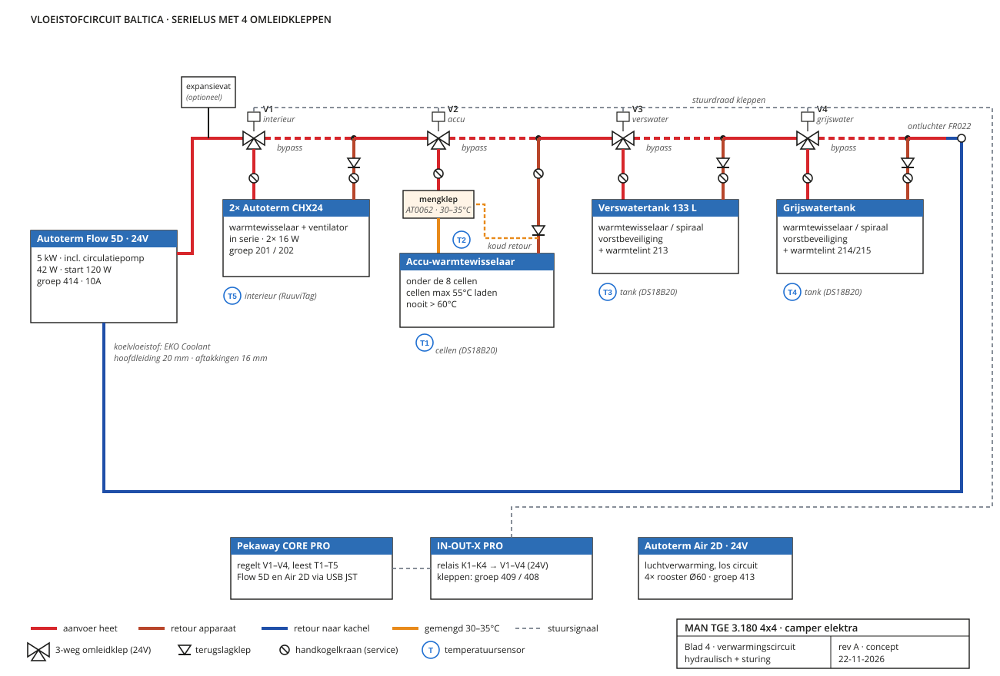

# Verwarming

- **Autoterm Flow 5D** (24V, 5 kW, diesel) met Baltica-componenten: vloeistofcircuit naar interieur, woonaccu en tanks
- **Autoterm Air 2D** (24V, 2 kW): luchtverwarming, los circuit
- **Vloeistof-standkachel af fabriek**: alleen motorcircuit

## Blad 4 – Verwarmingscircuit

Centraal kleppenblok met **4 24V-kleppen**: één per circuit (interieur, woonaccu, verswater, grijswater, en de vloer als eigen circuit). Er staat steeds maar **één circuit tegelijk open**. Er zit **geen mengklep** in het koelvloeistofcircuit; de koelvloeistof blijft ±80 °C. De enige mengklep zit op het sanitaire warmwater.

Voor de woonaccu wordt de koelvloeistof van ±80 °C in **korte pulsen** aangeboden: start met 10 s open en bepaal de juiste duur empirisch, op basis van de continue meting van buiten- en accutemperatuur.

!!! note "Vervallen"
    Mengklep AT0062 en de V2-bypass vervallen. Het schema (blad 4) moet nog worden aangepast.

## Regeling (CORE PRO)

| Circuit | Klep open als | Opmerking |
|---|---|---|
| Interieur | T5 < instelling | één circuit tegelijk open |
| Woonaccu | T1 (accu) laag, in pulsen | start 10 s open, duur empirisch bepalen op buiten- en accutemperatuur |
| Verswater | T3 < 3 °C | |
| Grijswater | T4 < 3 °C | |
| Vloer | apart aangestuurd | eigen circuit, zie [Vloer](../interieur/vloer.md) |

## Open punten
- [ ] Vloerverwarming (buis in de Bo-dapter-vloer) als eigen circuit op het centrale kleppenblok (klep 4)
- [ ] 24V-kleppen: leverbaar? stand zonder stroom?
- [ ] Pulsduur voor de woonaccu bepalen op basis van metingen (buiten- en accutemperatuur)
- [ ] 2-wegkranen tanks: in het koelvloeistofcircuit of aftapkranen?
- [ ] Extra vloeistofpomp nodig naast de pomp van de Flow 5D?
